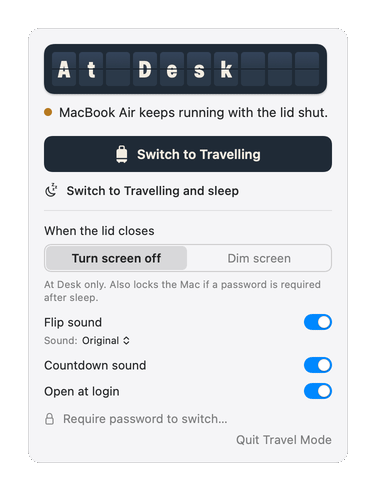
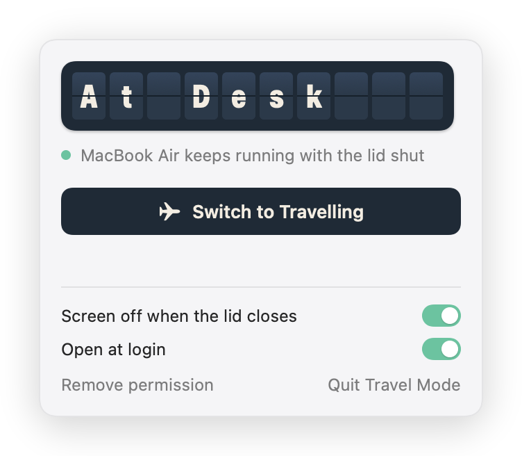
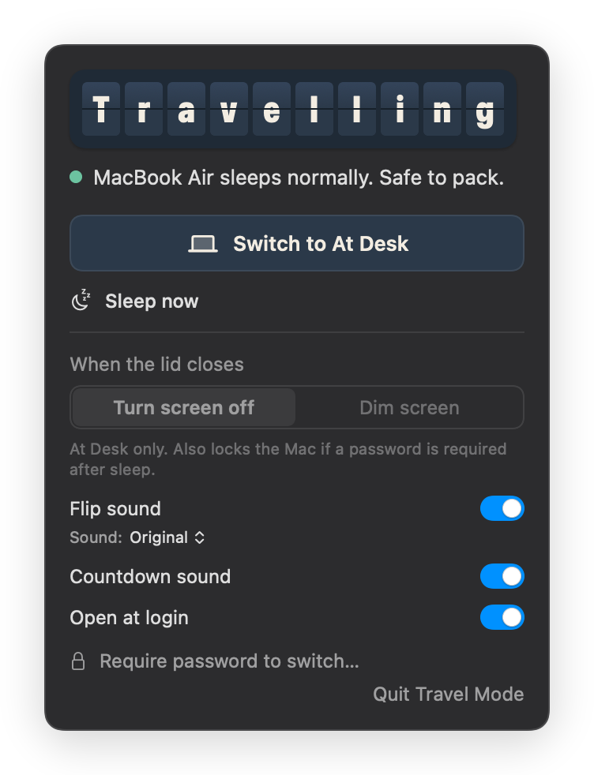

# Travel Mode

A tiny menu bar app for MacBooks that switches between two modes:

- **At Desk**: the MacBook keeps running with the lid shut. Leave it closed on a hub or stand, as a home server or headless machine, and still reach it with Screen Sharing, ssh or a remote-desktop app.
- **Travelling**: the MacBook sleeps normally, so it's safe to put in a bag.

Closing a MacBook's lid always puts it to sleep, unless an external display is connected. macOS has no setting to change that. Travel Mode makes it one click, and one click back before you pack.

<p align="center"></p>

| At Desk | Travelling (dark mode) |
|---|---|
|  |  |

## Do you need it?

| Your Mac | Use |
|---|---|
| **MacBook** you want to use closed, without an external display | **Travel Mode** |
| MacBook with an external display, keyboard and power | macOS's own clamshell mode already keeps it running |
| **Mac mini, Mac Studio, iMac, Mac Pro** | **You don't need this.** Turn on *Prevent automatic sleeping when the display is off* in System Settings › Energy. That keeps it running as a server and still lets you sleep it from the Apple menu, which At Desk doesn't. |

The app still runs on desktop Macs. There it says it was made for MacBooks and links to the Energy settings.

## What it does

- Shows the current mode in the menu bar: a laptop at your desk, an airplane when travelling.
- Switches with one click. The board flips letter by letter, like an airport departure board. With Reduce motion on, it fades instead.
- **Sleep now**, while travelling, puts the Mac to sleep right away.
- **Screen off when the lid closes** (on by default). At Desk, macOS keeps the built-in screen lit inside a closed lid until the display-sleep timer runs out. Travel Mode turns it off the moment the lid closes. If your Mac asks for a password after the display sleeps, that also locks it. Waking the screen remotely afterwards still works.
- **Open at login**, from the panel.
- A command line for scripts:
  ```bash
  "/Applications/Travel Mode.app/Contents/MacOS/TravelMode" --status   # desk | travelling
  "/Applications/Travel Mode.app/Contents/MacOS/TravelMode" --info     # mode, this Mac, setup state
  "/Applications/Travel Mode.app/Contents/MacOS/TravelMode" --desk
  "/Applications/Travel Mode.app/Contents/MacOS/TravelMode" --travel
  ```

## How it works

At Desk mode is macOS's own `pmset -a disablesleep 1`; Travelling is `pmset -a disablesleep 0`. Both need administrator rights.

On first launch, **Set up** asks for your password once and installs a sudo rule at `/etc/sudoers.d/travel-mode`. It lets your account run exactly these two commands without a password, and nothing else:

```
you ALL=(root) NOPASSWD: /usr/bin/pmset -a disablesleep 0, /usr/bin/pmset -a disablesleep 1
```

The rule is checked with `visudo` before and after it's installed, and removed again if either check fails. **Remove permission** in the panel deletes it. You can skip setup entirely; macOS then asks for your password each time you switch.

> [!WARNING]
> At Desk, the Mac doesn't sleep, even with the lid closed or from  → Sleep. Don't put it in a bag in At Desk mode: it stays awake, gets warm and drains the battery. Switch to Travelling first.

For lid-closed use, keep the Mac on power. If you want it to also work with an external display and keyboard, macOS's own clamshell mode does that without this app.

## Install

Requires macOS 14 or later, on Apple silicon or Intel.

### Build from source (recommended)

Needs Xcode or the Command Line Tools.

```bash
git clone https://github.com/Elwinc2799/travel-mode.git
cd travel-mode
scripts/build.sh
mv "build/Travel Mode.app" /Applications/
open "/Applications/Travel Mode.app"
```

### About signing

The app is ad-hoc signed, not notarized; there's no paid Apple Developer ID behind it. A copy you build yourself opens normally. A copy downloaded from someone else is blocked by Gatekeeper; right-click it, choose **Open**, then confirm.

## Uninstall

1. In the panel, choose **Remove permission**, then **Quit Travel Mode**.
2. Delete `Travel Mode.app`.
3. Make sure sleep is back on:
   ```bash
   sudo pmset -a disablesleep 0
   ```

## Development

```bash
swift build                 # build everything
scripts/build.sh            # make build/Travel Mode.app (universal)
ARCHS=arm64 scripts/build.sh   # Apple silicon only, faster
scripts/preview.sh          # re-render docs/*.png and docs/flip.gif (needs ffmpeg)
```

- `Sources/TravelModeKit/`: the panel, the split-flap board, and the code that reads and changes sleep.
- `Sources/TravelMode/`: the menu bar app and the command line.
- `Tools/RenderPreview/`: renders the README images with demo data. It never touches your real settings.
- `Tools/MakeIcon/icon.swift`: draws the app icon.

## License

MIT. See [LICENSE](LICENSE).
